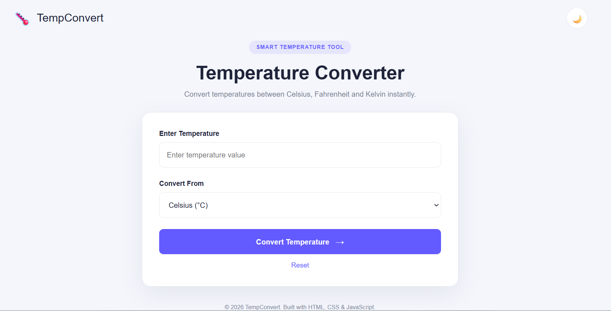
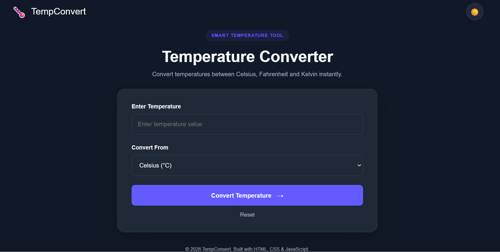
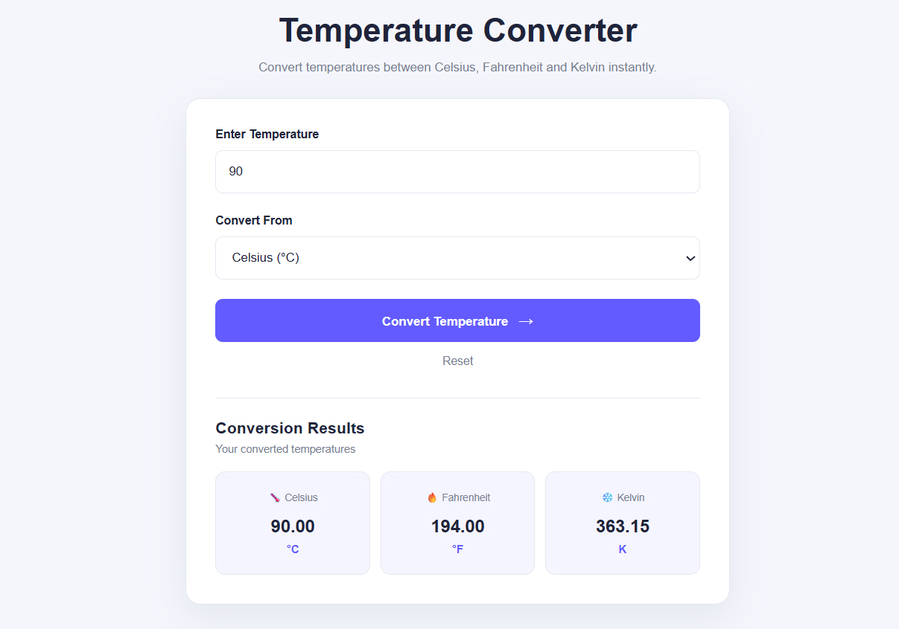

# 🌡️ Temperature Converter Website

A modern, responsive, and interactive Temperature Converter Website developed using **HTML5, CSS3, and Vanilla JavaScript** as part of my **Oasis Infobyte Web Development Internship – Task 3**.

The application allows users to convert temperatures between Celsius, Fahrenheit, and Kelvin with real-time input validation and a clean, user-friendly interface.


## 📌 Project Overview

The Temperature Converter is a web-based tool designed to make temperature conversions simple and fast. Users can enter a temperature, select the input unit, and instantly view the equivalent values in all three temperature scales.

## ✨ Features

- **Three Temperature Units:** Celsius, Fahrenheit, and Kelvin.
- **Instant Conversion:** Displays all three converted values simultaneously.
- **Input Validation:** Detects empty and invalid numeric inputs.
- **Absolute Zero Validation:** Prevents temperatures below absolute zero.
- **Dark & Light Mode:** Switch between professional themes.
- **Reset Functionality:** Clear input and conversion results.
- **Responsive Design:** Works on desktops, tablets, and mobile devices.
- **User-Friendly Interface:** Clean layout with clear labels and result cards.

## 🛠️ Technologies Used

| Technology | Purpose |
|---|---|
| HTML5 | Website structure |
| CSS3 | Styling and responsive design |
| JavaScript | Conversion logic and validation |

## 🌡️ Conversion Formulas

The application uses the following mathematical formulas:

**Celsius to Fahrenheit**

```javascript
F = (C × 9/5) + 32;
```

**Fahrenheit to Celsius**

```javascript
C = (F - 32) × 5/9;
```

**Celsius to Kelvin**

```javascript
K = C + 273.15;
```

**Kelvin to Celsius**

```javascript
C = K - 273.15;
```

## 📂 Project Structure

```text
Task 3 - Temperature Converter/
│
├── index.html
├── style.css
├── script.js
└── README.md
```

## ⚙️ Installation & Setup

Follow these steps to run the project locally:

1. Clone the repository:

```bash
git clone https://github.com/Ashish-bit-art/OIBSIP.git
```

2. Open the repository folder.

3. Navigate to:

```text
Web Development/Level 1/Task 3 - Temperature Converter/
```

4. Open the `index.html` file in your browser.

5. Alternatively, use the VS Code Live Server extension.

## 🧪 Test Cases

| Input | Unit | Expected Result |
|---|---|---|
| 100 | Celsius | 212°F, 373.15 K |
| 32 | Fahrenheit | 0°C, 273.15 K |
| 273.15 | Kelvin | 0°C, 32°F |
| -273.15 | Celsius | -459.67°F, 0 K |
| -300 | Celsius | Validation error |
| -500 | Fahrenheit | Validation error |
| abc | Any | Invalid input error |
| Empty | Any | Required field error |

## 📸 Screenshots

### ☀️ Light Mode


### 🌙 Dark Mode


### 🌡️ Temperature Conversion Results


## 🎯 Internship Details

- **Organization:** Oasis Infobyte
- **Internship Domain:** Web Development
- **Task Number:** Task 3
- **Project Name:** Temperature Converter Website
- **Technology Stack:** HTML5, CSS3, JavaScript

## 👨‍💻 Author

**Ashish Kumar**

Frontend Developer | Angular Developer | Flutter Developer

- GitHub: [Ashish-bit-art](https://github.com/Ashish-bit-art)

## 📄 License

This project is created for educational and internship purposes.

---

⭐ If you find this project useful, consider giving the repository a star!

**Built with ❤️ using HTML, CSS & JavaScript.**
